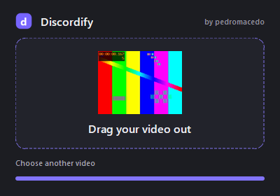

# Discordify

### Your video. Small enough to send.

Ever been ready to share a clip, only for Discord to tell you **the file is too large**?
Now you’re opening a video editor, guessing bitrates, exporting again… all just to send one video.

**Discordify takes care of it. Drop your video in. Get a Discord-ready MP4 out.**

No settings to figure out. No uploads. No account. Drag in, compress, drag out.

**[Download for Windows](https://github.com/pmacedoo/discordify/releases/latest)** · Free and open source · **by pedromacedo**


## Less fiddling. More sharing.

- **Under 19 MB, automatically.** Compression and resolution are adjusted for you, and the file size is checked before saving.
- **Let your PC choose the fast path.** Discordify measures CPU and compatible GPU encoders, then picks automatically. No switches or presets.
- **Keep your original FPS.** Your 60 FPS clip stays 60 FPS. Variable frame rates are supported, too.
- **Keep the whole clip.** No trimming the ending just to fit a size limit.
- **Keep your original file.** The compressed copy is saved right next to it. Existing files stay untouched.
- **Keep it on your computer.** Processing is local. Your videos aren’t uploaded anywhere.
- **Out of the way when you’re done.** Close the window and Discordify stays in your system tray, ready for the next clip.

Already have an MP4 under 19 MB? Discordify leaves it as it is, avoiding unnecessary quality loss.

## Drag. Drop. Send.

1. **Open Discordify.** No installation required. The interface is in English and keeps only the essentials.
2. **Drop in your video.** Or click the drop area to choose a file.
3. **Drag it out.** When the window says **“Drag your video out,”** drag from the center straight into Discord, a folder, or another app that accepts file drops.



The result shows a preview frame from your video, and the same thumbnail follows your cursor while dragging. The drag copies the file, so your saved result stays where it is. To compress the next clip, drop it into the window or click **Choose another video**.
You can still find your `_discordify.mp4` beside the original, or click the notification to open its folder.

You can also drop a video directly onto `Discordify.exe`. Right-click the tray icon to cancel a conversion or quit.

## Right-click a video to compress it

Right-click the Discordify tray icon and choose **Add to right-click menu** once.
You can then right-click a supported video in Explorer and select **Compress with Discordify**.
On Windows 11, it appears under **Show more options**.

This is a per-user integration: no administrator access or default file-association changes.
It keeps a versioned app copy in `%LOCALAPPDATA%/Discordify/app/` so the menu keeps working if you move the downloaded EXE.
Use **Remove from right-click menu** in the tray to remove the menu entries. The app copy remains in that folder.

## Get Discordify

**[Download the latest release →](https://github.com/pmacedoo/discordify/releases/latest)**

Choose `Discordify.exe` to get started, or grab the ZIP with documentation and license information included.
Requires **Windows 10 or 11, 64-bit**. Python and FFmpeg are bundled. The executable is currently unsigned.

The target is **19,000,000 bytes**. Discord’s upload limits depend on your account and context; check the limit shown in your client.
Very long videos may not fit with usable quality. Discordify reports an error rather than saving an incomplete result.
One video is processed at a time. Output uses H.264 video and AAC audio.

<details>
<summary><strong>For developers</strong></summary>

### Build from source

```powershell
python -m venv .venv
.venv\Scripts\python -m pip install -r requirements.txt
.venv\Scripts\python build.py
.venv\Scripts\python tests\test_compression.py
```

### Automatic encoder selection

Discordify tests compatible H.264 encoders (NVIDIA NVENC, Intel Quick Sync, AMD AMF, and the CPU) using a short sample of your video.
Two sample lengths help estimate startup cost and sustained encoding time. A sample SSIM check rejects candidates more than 0.02 below the CPU reference.
This is a practical estimate, not a guarantee that one encoder is fastest or best for every scene.

Choices are cached locally for similar resolution, frame rate, bitrate, and duration profiles, for up to seven days.
Hardware/driver changes invalidate the profile. The first conversion in a new profile includes a brief calibration; later conversions reuse the result.
If the selected GPU fails during conversion, Discordify retries on the CPU and removes that cached decision.
The app uses one-pass encoding and verifies the actual output size, reducing the bitrate and retrying when needed.

The executable is written to `dist/Discordify.exe`. The build bundles FFmpeg and generates the application icon.
After building, run `python src/discordify.py` to work on the interface.
Use `python build.py --dist-dir dist/v1.2.0` to build alongside a running older version.
The **Build Windows** workflow can also build the executable manually through GitHub Actions.

### Tested with real video conversion

CPU and NVIDIA NVENC conversions both preserved **60 FPS, all 480 frames, and audio**, producing outputs below the size limit.
The selection chose NVENC for the 720p/60 FPS sample and the CPU for smaller samples on the test PC.
Additional tests cover 29.97 FPS, variable frame rates on CPU and NVENC, cancellation, invalid input, cache reuse, and simulated GPU failure followed by a real CPU conversion.
Intel Quick Sync and AMD AMF could not be validated on physical hardware in this environment.
Frame timings are preserved within container precision. See [VALIDACAO.txt](VALIDACAO.txt) for the test record.

</details>

## Made by pedromacedo

Free and open source under [GPL-3.0-or-later](LICENSE). Copyright © 2026 pedromacedo.
See [THIRD_PARTY.md](THIRD_PARTY.md) for dependencies and their source code.

Discordify is an independent project and is not affiliated with Discord.
