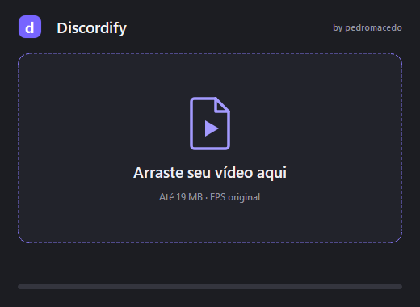

# Discordify

**by pedromacedo**

Arraste um vídeo. Receba um MP4 de até **19 MB**, com o **FPS original**.
Sem configurações, sem upload e sem instalação.



## Download

Baixe `Discordify.exe` na [última release](https://github.com/pmacedoo/discordify/releases/latest).
Requer Windows 10/11 de 64 bits. Não precisa instalar Python ou FFmpeg.

## Como usar

1. Abra o executável e arraste um vídeo para a janela. Clicar na área também permite escolher um arquivo.
2. Aguarde. O resultado fica na pasta do original, com o sufixo `_discordify.mp4`.
3. Clique na notificação para abrir a pasta do resultado.

Fechar a janela mantém o aplicativo na bandeja. Use o botão direito no ícone para cancelar uma conversão ou sair.
Também é possível arrastar um vídeo sobre o próprio executável.

## Comportamento

- Limite de **19.000.000 bytes**, conferido antes de salvar.
- Preserva os quadros e seus tempos, inclusive em vídeos com FPS variável, com a precisão dos formatos.
- Ajusta bitrate e resolução automaticamente; usa H.264 e AAC.
- Preserva o original e não sobrescreve resultados anteriores.
- MP4 que já está dentro do limite não é recodificado.
- Processa um vídeo por vez, localmente, sem cortar a duração para caber.

Vídeos muito longos podem não caber com qualidade utilizável. Nesses casos, o aplicativo informa o erro.
O executável ainda não tem assinatura digital.

## Desenvolvimento

```powershell
python -m venv .venv
.venv\Scripts\python -m pip install -r requirements.txt
.venv\Scripts\python build.py
.venv\Scripts\python tests\test_compression.py
```

O resultado é `dist/Discordify.exe`. O build inclui o FFmpeg e gera o ícone.
Após o build, execute `python src/discordify.py` para trabalhar na interface.
O workflow **Build Windows** também permite gerar o executável manualmente no GitHub Actions.

## Validação

O teste integrado do executável reduziu **26,2 MB para 18,7 MB**, mantendo **60 FPS e 480 quadros**, com áudio.
Também foram verificados 29,97 FPS, FPS variável, cancelamento e entrada inválida.
Detalhes em [VALIDACAO.txt](VALIDACAO.txt).

## Licença

Copyright (c) 2026 pedromacedo. Código sob [GPL-3.0-or-later](LICENSE).
Dependências e fontes estão descritas em [THIRD_PARTY.md](THIRD_PARTY.md).
Projeto independente, sem afiliação ao Discord.
